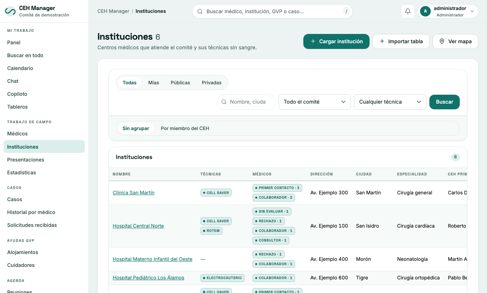

# 2. Médicos e instituciones

## Médicos

Menú **Médicos**. Hay tres vistas (botones de arriba): **fichas**, **tabla** y **mapa**. El buscador encuentra por nombre, especialidad o cargo, y se puede filtrar por especialidad, institución, consultores, TJ y urgencias.

### La ficha

Al abrir un médico se ve: datos, instituciones donde atiende, especialidades, **seguimiento** (contactos registrados), comentarios y el formulario HLC-31.

### Cargar un médico nuevo

1. **Antes, buscalo** para no duplicarlo.
2. Médicos → **Cargar médico**.
3. Completá nombre y apellido (lo demás es opcional). Dirección, cómo sacar turno y seguimiento están plegados en **«Más datos»**: tocá el título para abrirlos.
4. Elegí la institución, la especialidad y la fecha del último contacto.
5. Guardá. Desde la ficha se pueden sumar más instituciones, especialidades y contactos. Al crearlo podés descargar el HLC-31 marcado «contacto nuevo».

### Registrar un contacto

En la ficha, sección de seguimiento: **registrar contacto** con la fecha, quién del CEH lo contactó y observaciones. La fecha del último contacto marca si el médico está **al día**, **por vencer** o **vencido** (los plazos los define el administrador).

### Nivel de cooperación

Sin evaluar, **Primer contacto**, **Cooperativo** o **Rechazo**. Un cooperativo puede ser además consultor. Se cambia editando la ficha.

## Instituciones

Menú **Instituciones**: hospitales, clínicas y farmacias. Botones: Cargar institución, Importar tabla, Ver fichas, Ver tabla y Ver mapa.

La ficha muestra datos, titular y auxiliar del CEH a cargo, técnicas de ahorro de sangre, los médicos que atienden ahí y el formulario HLC-29. Dirección, contacto y comentarios están en «Más datos». **Solo el titular, el auxiliar o un administrador pueden editarla.**

## Importar desde una planilla

Médicos o Instituciones → **Importar tabla**.

1. Pegá la tabla (se puede copiar desde Excel) o subí un CSV. **La primera fila debe tener los nombres de las columnas.** Máximo 2000 filas.
2. El sistema la compara con lo que ya hay y muestra una **vista previa**: nuevos, ya existentes, para revisar y con error. Los nombres de columna se reconocen solos y se pueden corregir.
3. Recién al apretar **Confirmar e importar** se carga.

Cómo evita duplicados:

- **Instituciones:** mismo nombre y ciudad, o mismo correo.
- **Médicos:** mismo nombre **y** un dato que lo confirme (correo, teléfono o una institución en común). Si solo coincide el nombre, queda «para revisar» y no se carga.
- Varias instituciones o especialidades en una celda: separadas con `|`.
- Opciones: **completar existentes** (solo rellena campos vacíos, nunca pisa datos) y **crear instituciones faltantes**.
- Reimportar el mismo archivo no duplica. Cada fila es independiente: si una falla, las demás se cargan.

## Buscar médicos e instituciones en internet

Si el comité lo habilitó, el [copiloto](07-copiloto.md) puede buscar especialistas e instituciones indicando **una especialidad y un lugar** (por ejemplo «cardiología en Rosario»), o los médicos que atienden en una institución ya cargada.

- **No se puede buscar a una persona por su nombre.**
- A internet solo salen la especialidad y el lugar (o el nombre y la ciudad de la institución), nunca datos de pacientes.
- Cada dato cargado guarda **de qué página salió y qué día se leyó**: solapa **«Fuentes»** de la ficha.
- Lo que aparece viene de otros sitios: **verificalo antes de confirmar**. Cargá solo datos de contacto que publica el propio profesional o su institución.
