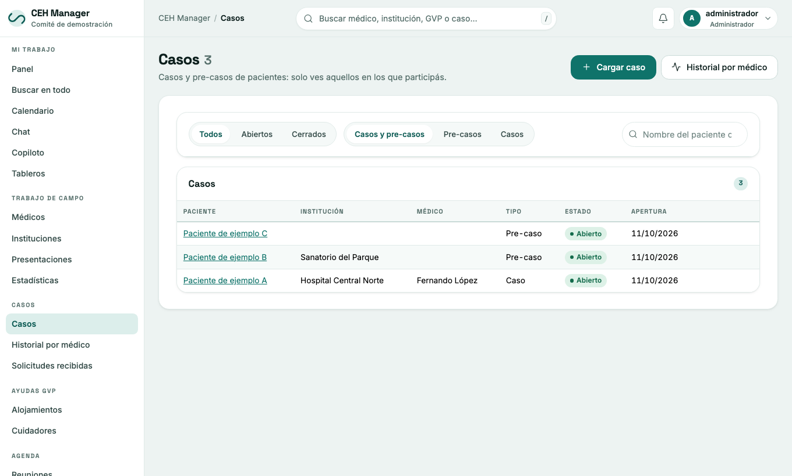

# 3. Casos de pacientes

Menú **Casos** → **Cargar caso**.

Cada caso reúne:

- la ficha del paciente, el médico y la institución;
- notas, tareas y laboratorios;
- las personas asignadas;
- el formulario **HLC-7**.

Un caso se puede **elevar** o **cerrar**. **Historial por médico** agrupa los casos por médico.

## Solicitudes por internet

Las solicitudes que llegan por el formulario público aparecen en **Casos → Solicitudes**. Cada una guarda cuándo se aceptó la política de privacidad y qué versión.

## Cuidado con los datos

- Son datos de salud: usalos solo para la tarea del comité.
- **No pongas datos de pacientes en el chat ni en los tableros.**
