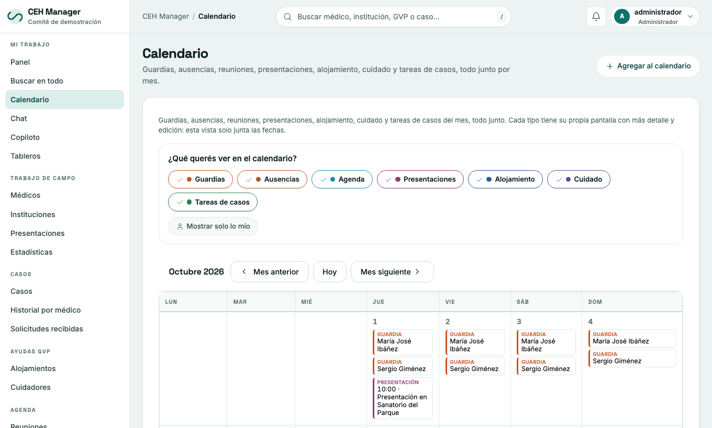

# 4. Comité: personas, agenda y guardias

## Miembros y ayudantes (personas y cuentas)

Menú **Configuración del sistema → Miembros y ayudantes**: una sola lista de personas. Cada una es de un tipo:

| Tipo | Qué es |
|---|---|
| **CEH** | Miembro del comité |
| **GVP** | Miembro del GVP (con miembro del CEH a cargo) |
| **Ayudante** | Colabora con el comité, con un miembro del CEH a cargo |
| **Otro (solo acceso)** | Usa el sistema sin ser del comité (por ejemplo, quien lo administra). Solo lo ve el administrador |

- **Cargar persona:** un único formulario con nombre, contacto, dirección y los datos según el tipo.
- **Editar:** foto (tocándola o arrastrando una imagen), tipo, contacto, **etiquetas libres** (para clasificar y buscar, por ejemplo «traductor»), dirección con mapa y observaciones.
- El **tipo** se puede cambiar mientras la persona no tenga registros asociados (casos, guardias, agenda…).
- Se puede **filtrar por tipo** y **Ver mapa** muestra las direcciones.
- Desde GVP también se ven los ofrecimientos de alojamiento y de cuidado.

### Cuenta de acceso

La ficha muestra, para el administrador, usuario, rol, estado, verificación en dos pasos y último acceso. Desde ahí se puede **editar la cuenta**, **resetear la verificación en dos pasos**, **quitar el acceso** (la persona sigue cargada) o **darle acceso**. Eliminar una persona elimina también su cuenta.

## Agenda y reuniones

Menú **Comité → Agenda**: **Convocar reunión**, ver el calendario y **confirmar asistencia**. El calendario junta reuniones, guardias y ausencias.

## Guardias y ausencias

- **Comité → Guardias → Cargar guardia**: calendario de quién está de guardia.
- **Ausencias → Cargar ausencia**: avisá cuándo no vas a estar disponible.
