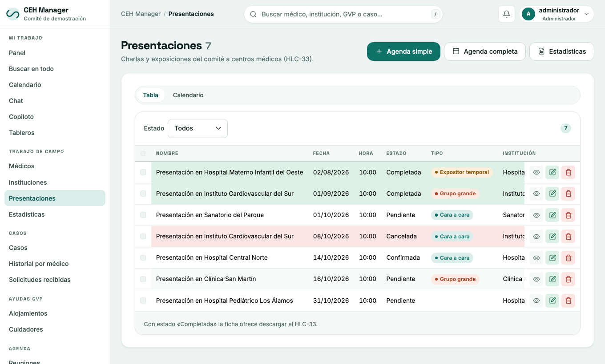
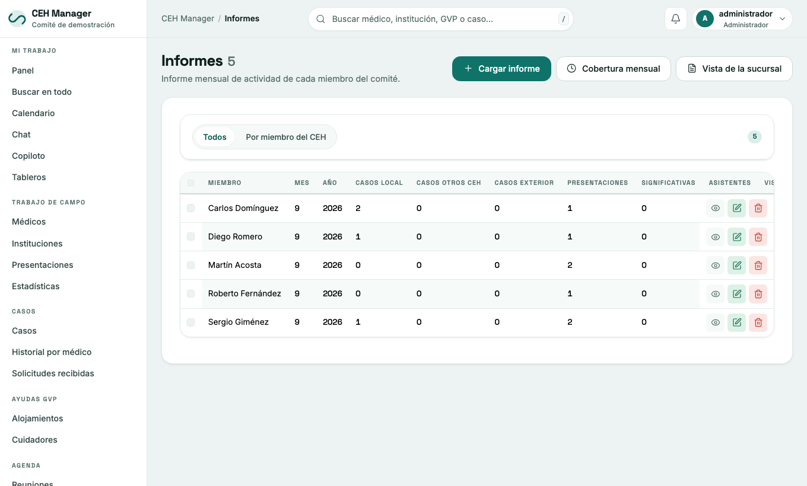

# 5. Presentaciones, informes, publicaciones y recursos

## Presentaciones

Menú **Presentaciones**: presentaciones a médicos e instituciones (presencial, en línea, PowerPoint, exhibidor) con su estado: pendiente, confirmada, completada o cancelada. Hay agenda simple y completa, estadísticas y el formulario **HLC-33**.

## Informes mensuales

Menú **Informes → Cargar informe**. Cada miembro del CEH entrega el suyo cada mes.

- **Cobertura mensual**: quién entregó y quién falta.
- **Vista de la sucursal**: resumen de la actividad.

## Publicaciones

Menú **Publicaciones**: stock y pedidos (pedido óptimo o conservador, formulario **CEH-3**).

## Recursos

Menú **Recursos**:

- **Cargar bien**: inventario con aviso de vencimiento. Tildando varios se puede **Reasignar a…** otro miembro o **Cambiar estado…** de todos juntos.
- **Cargar acta**: actas de reuniones con su documento.
- **Cargar correspondencia**.
