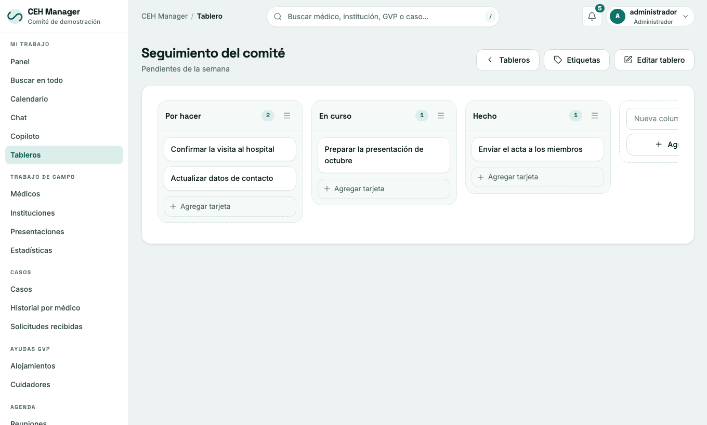

# 6. Chat, tableros y notificaciones

## Chat

Mensajes con otras cuentas y **canales**. El globo de abajo a la derecha abre el chat rápido. Se pueden mandar fotos, archivos y **notas de voz**. Debajo de cada nota de voz está **«Transcribir»**, que la pasa a texto (lo ven todos los del canal); aparece solo si el copiloto está configurado.

## Tableros

Tableros de tareas tipo Kanban: columnas, tarjetas, etiquetas y comentarios.

> **No pongas datos de pacientes en el chat ni en los tableros.**

## Notificaciones

La campanita muestra avisos de casos, tareas, reuniones, guardias y chat. «Marcar todas como leídas» las limpia. Para recibirlos en el celular, activá las notificaciones del navegador.
