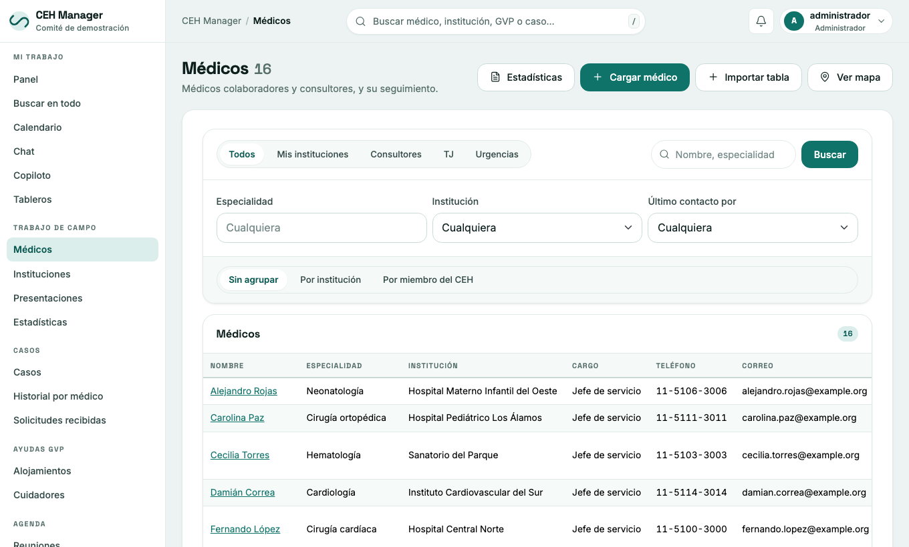

# Manual de usuario — CEH Manager

Guía de uso del sistema del Comité de Enlace con los Hospitales. Para **instalar** el sistema y descargarlo, ver [ceh-releases](https://github.com/ceh-teams/ceh-releases).

Las capturas son del modo demo, con datos inventados.

## Índice

1. [Primeros pasos](01-primeros-pasos.md): ingresar, verificación en dos pasos, moverse por el sistema.
2. [Médicos e instituciones](02-medicos-e-instituciones.md): fichas, seguimiento, importar tablas, búsqueda en internet.
3. [Casos de pacientes](03-casos.md)
4. [Comité: personas, agenda y guardias](04-comite.md)
5. [Presentaciones, informes, publicaciones y recursos](05-presentaciones-informes-recursos.md)
6. [Chat, tableros y notificaciones](06-chat-y-notificaciones.md)
7. [Copiloto (inteligencia artificial)](07-copiloto.md)
8. [Formularios oficiales (PDF)](08-formularios.md)
9. [Administración](09-administracion.md): roles, integraciones, textos legales, copias.
10. [Preguntas frecuentes](10-preguntas-frecuentes.md)

## Antes de empezar

- Cada persona ve **solo las secciones que permite su rol**. Si falta una sección que necesitás, pedísela a quien administra.
- Este repositorio es público: no escribas acá datos de pacientes, médicos reales ni claves.
- ¿Encontraste un error en el manual? [Abrí un issue](https://github.com/ceh-teams/ceh-manual/issues/new).
